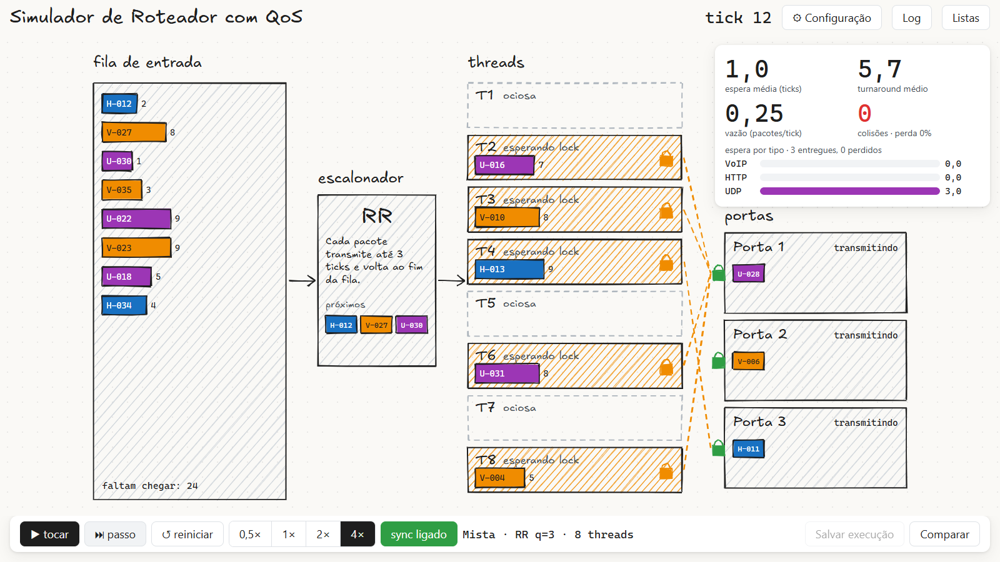
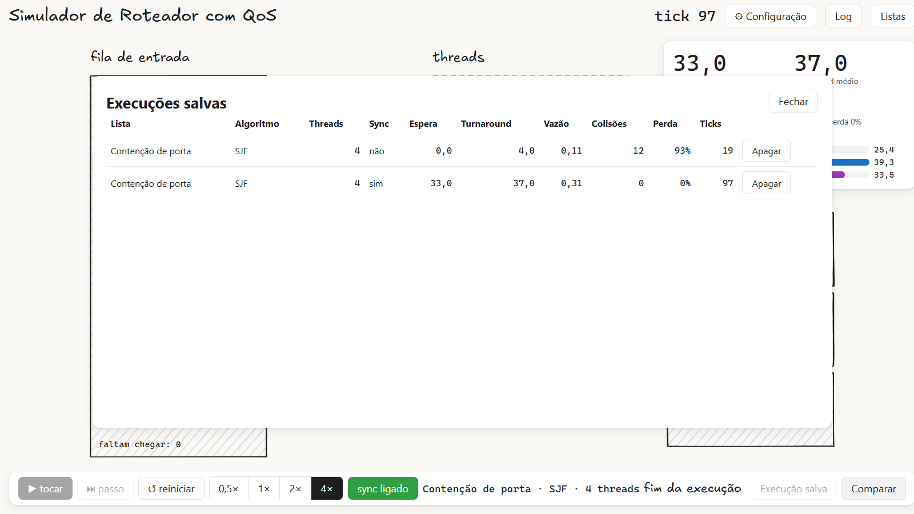
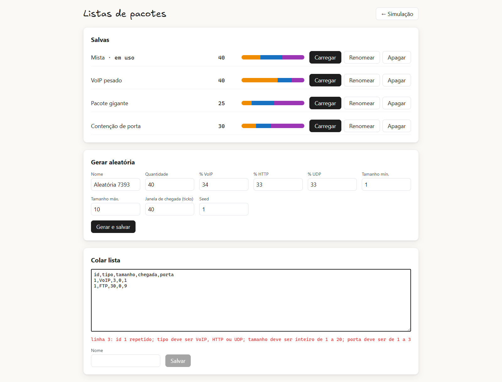

<div align="center">

# Simulador de Roteador com QoS

*Escalonamento de pacotes e sincronismo entre threads reais, visto tick a tick*

[](tsconfig.json)
[](https://vite.dev)
[](#scripts)
[](#)

[Funcionalidades](#funcionalidades) • [Como rodar](#como-rodar) • [Como funciona](#como-funciona) • [Resultados](#resultados) • [Estrutura](#estrutura-do-projeto)

</div>



Um roteador recebe pacotes VoIP, HTTP e UDP de uma lista estática, um **escalonador central** escolhe qual pacote vai para cada thread e as threads (**Web Workers reais**) transmitem pelas 3 portas de saída. Com o sincronismo ligado, cada porta é protegida por um **ticket lock feito à mão com `Atomics`**; desligado, threads podem escrever na mesma porta ao mesmo tempo e os pacotes colidem.

Trabalho da disciplina C12, feito em dupla.

## Funcionalidades

- **3 escalonadores implementados à mão**, com a mesma interface: SJF, Round Robin e Prioridade
- **Threads reais**: um Web Worker por thread (1 a 8), sincronizados por um relógio lógico de ticks
- **Com e sem sincronismo**: mutex por porta sobre `SharedArrayBuffer`, ou colisões detectadas e registradas
- **Métricas**: espera média (geral e por tipo), turnaround, vazão, colisões e taxa de perda
- **Comparação de execuções**: salve execuções terminadas e compare lado a lado
- **Listas de pacotes**: 4 presets, gerador aleatório com seed, colar JSON/CSV com validação, salvar, renomear e apagar
- **Visual para projetor**: diagrama desenhado à mão no estilo Excalidraw, com efeitos no lugar de cada evento

## Como rodar

Requisitos: [Node.js](https://nodejs.org) 22 ou superior e um navegador baseado em Chromium ou Firefox atual.

```bash
npm install
npm run dev
```

Abra http://localhost:5173.

> [!IMPORTANT]
> O `SharedArrayBuffer` só existe em páginas *cross-origin isolated*. O `vite.config.ts` já envia os headers COOP/COEP no `dev` e no `preview`. Abrir o `index.html` direto do disco ou hospedar sem esses headers (ex.: GitHub Pages) não funciona.

### Scripts

| Comando | O que faz |
|---|---|
| `npm run dev` | servidor de desenvolvimento |
| `npm test` | testes com Vitest (a engine roda sem workers, com as threads em sequência) |
| `npm run build` | typecheck e build de produção em `dist/` |
| `npm run preview` | serve o build com os headers de isolamento |

## Como usar

1. Em **Configuração**, escolha a lista, o algoritmo, o quantum (só RR) e o número de threads. Mudar qualquer item reinicia a execução.
2. Use **▶ tocar** ou **⏭ passo** para avançar; a velocidade vai de 0,5× a 4×.
3. Ligue e desligue o **sync** na barra de baixo para ver colisões aparecerem e sumirem.
4. Quando a execução terminar, clique em **Salvar execução** e depois em **Comparar**.
5. Em **Listas**, gere listas novas ou cole as suas.



### Formato das listas

JSON (array) ou CSV com cabeçalho. Qualquer linha inválida rejeita a lista inteira, com o motivo por linha.



```csv
id,tipo,tamanho,chegada,porta
1,VoIP,3,0,1
2,HTTP,5,1,2
3,UDP,2,1,3
```

| Campo | Regra |
|---|---|
| `id` | inteiro, único |
| `tipo` | `VoIP`, `HTTP` ou `UDP` (sem diferenciar maiúsculas) |
| `tamanho` | inteiro de 1 a 20; é o número de ticks que a transmissão ocupa |
| `chegada` | tick em que o pacote entra na fila, inteiro ≥ 0 |
| `porta` | porta de destino, de 1 a 3 |

## Como funciona

A cada tick:

1. Pacotes com `chegada == tick` entram na fila de entrada.
2. O escalonador entrega pacotes às threads ociosas. Ele **não sabe** se a porta de destino está ocupada; é isso que gera disputa.
3. As threads executam o tick em duas fases, cada uma com barreira: primeiro quem terminou a fatia libera o lock, depois cada thread transmite 1 unidade, espera o lock ou colide.
4. A engine lê o resultado no buffer compartilhado, detecta colisões e publica um retrato imutável do tick para a interface.

| Algoritmo | Regra |
|---|---|
| **SJF** | menor tamanho primeiro, não preemptivo |
| **Round Robin** | transmite até *quantum* ticks e volta ao fim da fila; a próxima fatia pode ir para outra thread |
| **Prioridade** | VoIP > HTTP > UDP, empate por chegada, sem aging |

| Métrica | Definição |
|---|---|
| Turnaround | tick de entrega − chegada |
| Espera | turnaround − tamanho (fila, espera por lock e intervalo entre fatias) |
| Vazão | pacotes entregues ÷ ticks |
| Colisão | duas threads ou mais na mesma porta no mesmo tick; os pacotes envolvidos são **perdidos**, sem retransmissão |

> [!NOTE]
> Pacotes perdidos ficam fora das médias de espera e turnaround e aparecem na taxa de perda. Com sync, dois pedidos de lock no mesmo tick são decididos pela corrida real entre as threads, então a espera pode variar levemente entre execuções idênticas.

As decisões e o porquê de cada uma estão em [`docs/decisoes.md`](docs/decisoes.md) e nas ADRs em [`docs/adr/`](docs/adr/).

## Resultados

Preset **Contenção de porta** (30 pacotes, quase todos para a porta 1), SJF, 4 threads:

| | Sync desligado | Sync ligado |
|---|---|---|
| Colisões | 12 | 0 |
| Pacotes perdidos | 28 de 30 (93%) | 0 |
| Espera média | 0 ticks | 33 ticks |
| Vazão (pacotes/tick) | 0,11 | 0,31 |
| Duração | 19 ticks | 97 ticks |

Sem sincronismo a execução termina rápido e sem espera, mas quase tudo se perde nas colisões. Com sincronismo as colisões somem, ao custo de espera: as threads ficam paradas aguardando o lock da porta disputada.

Os outros presets foram montados para evidenciar os demais comportamentos esperados:

| Preset | Montado para mostrar |
|---|---|
| Mista | comparação geral entre os três algoritmos |
| VoIP pesado | Prioridade favorecendo VoIP e o starvation do UDP |
| Pacote gigante | SJF com espera média baixa, mas o pacote de tamanho 20 esperando muito |
| Contenção de porta | colisões sem sync e as portas como gargalo com muitas threads |

## Estrutura do projeto

```
src/
  model/       tipos compartilhados (Pacote, ConfigSimulacao, Metricas...)
  lists/       parser JSON/CSV, gerador com seed, presets, CRUD em localStorage
  scheduler/   interface Escalonador + SJF, Round Robin, Prioridade
  sync/        layout do SharedArrayBuffer e ticket lock com Atomics
  workers/     o que uma thread faz em cada tick + o Web Worker
  engine/      simulação (relógio, fila, colisões), executores e controlador
  metrics/     cálculo das métricas
  ui/          telas Simulação e Listas, desenho do diagrama
docs/          descrição, decisões, ADRs, identidade visual e tasks
```

## Documentação

- [`CONTEXT.md`](CONTEXT.md): glossário do domínio
- [`docs/descricao.md`](docs/descricao.md): objetivo e requisitos da disciplina
- [`docs/decisoes.md`](docs/decisoes.md): decisões fechadas e em aberto
- [`docs/adr/`](docs/adr/): registros de decisões de arquitetura
- [`docs/design.md`](docs/design.md): identidade visual
- [`docs/tasks.md`](docs/tasks.md): andamento

A fonte Excalifont é distribuída sob a SIL Open Font License; veja [`public/fonts/Excalifont-OFL.txt`](public/fonts/Excalifont-OFL.txt).
